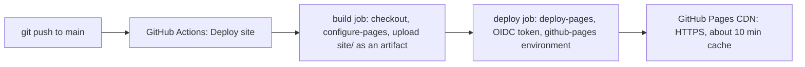

# Portfolio site and project template

- **Live site:** https://nahsamahammed106-gif.github.io/portfolio-site/
- **Template repo:** https://github.com/nahsamahammed106-gif/project-template

Project 1 of a 35-project roadmap toward a hybrid AI/ML engineering role. It has two parts:

1. **A portfolio site** built around an interactive grid of all 35 projects, colored by domain, which fills in as each one ships. It redeploys on every push to `main`.
2. **A project template**: a GitHub template repo with uv, pytest, CI and a README skeleton, so every later project starts from the same base in one command.

## Problem

My work had nowhere to be seen, and every new repo started from scratch.

## User

Recruiters and hiring managers, who need to see what I've built in a few seconds, and me, starting each new project.

## Tech stack

| Layer | Choice | Why |
|---|---|---|
| Site | Plain HTML, CSS and vanilla JavaScript (~850 lines, no build step) | Nothing to compile, nothing to break, and every line is explainable |
| Data | One file, `site/projects.js`, holding all 35 projects | Shipping a project is a one-line edit; the grid, counts and lists all derive from it |
| Fonts | Bricolage Grotesque + Source Serif 4, self-hosted woff2 (SIL OFL) | No third-party requests and no layout shift |
| Hosting | GitHub Pages | Free, HTTPS, deploys straight from Actions |
| CI/CD | GitHub Actions with the official Pages actions, pinned to commit SHAs | Push to `main` means live in about a minute |
| Dependency hygiene | Dependabot (alerts, security fixes, weekly version PRs) | Pinned actions still get updated |
| Template | uv, pytest, hatchling, GitHub Actions CI | Fast installs, a lockfile, and tests that run on every push |

## How code gets from a commit to production



- The workflow lives in [`.github/workflows/deploy.yml`](.github/workflows/deploy.yml). It runs on every push to `main`, and can also be started by hand from the Actions tab.
- The build job only reads the repo (`contents: read`). The deploy job proves its identity with a short-lived OIDC token (`id-token: write`), so no long-lived secret is stored anywhere.
- Every action is pinned to a full commit SHA, because a version tag like `v4` can be moved to different code. Dependabot opens PRs to move the pins forward.
- The `github-pages` environment only accepts deploys from `main`, and a repo ruleset blocks force-pushes and deletion of `main`.

## Architecture note

```
site/                    everything that gets deployed
  index.html             page shell: header, focus areas, roadmap, shipped list, about
  projects.js            the data: stages, tracks, disciplines, domains, 35 projects
  app.js                 renders the grid, detail panel, filters and shipped list
  styles.css             design tokens, layout, the load animation, light and dark themes
  fonts/                 two self-hosted variable fonts (Latin subset)
  og.png, favicon.svg, apple-touch-icon.png, 404.html, sitemap.xml
design/                  source pages for og.png and the touch icon (not deployed)
.github/
  workflows/deploy.yml   CI/CD to GitHub Pages
  dependabot.yml         weekly PRs for pinned actions
```

**Data flow:** `projects.js` sets `window.ROADMAP`, and `app.js` reads it once on load. From it, `app.js` builds the 35 grid buttons, the "What I work on" filters, the "x of 35 shipped" line and the Shipped list. All DOM building uses `textContent`, never `innerHTML`, so there's no HTML-injection path even if the data changes.

**Interaction model:**
- Hovering or focusing a square shows that project in the detail panel.
- The grid is a single tab stop; the arrow keys, Home and End move inside it (a "roving tabindex").
- Each discipline or domain previews its projects on hover and pins a filter on click; "Show all" clears it.

## Eval results

The site's "evals" are Lighthouse audits of the live page, run on simulated mobile and desktop.

| Metric | First version | Now |
|---|---|---|
| Accessibility | 100 | 100 |
| Best practices | 96 | 100 |
| SEO | 100 | 100 |
| Cumulative layout shift (mobile) | 0.184 | 0 |
| Console errors | 1 (missing favicon) | 0 |
| Text contrast, light and dark (lowest pair) | not measured | 4.96:1 (WCAG AA needs 4.5:1) |

Template: cloning it, installing with `uv sync` and running the tests took **5 seconds**. The full start from the template will be timed at the start of project 2.

## What broke and why

- **The local preview server couldn't start.** `python -m http.server` crashed with `PermissionError` on `os.getcwd()`. macOS privacy rules stop background processes from reading `~/Desktop`. The fix was to serve a copy from a folder outside the Desktop.
- **New deploys looked stale.** GitHub Pages sends `Cache-Control: max-age=600`, so for up to 10 minutes the browser kept the old CSS even after a successful deploy. Lesson: check the deploy run, not the page; test with a cache-busting query string, and remember that only busts the HTML, not the CSS it links to.
- **The hover lift never worked.** The load animation used `animation-fill-mode: both`. A finished animation with `both` keeps applying its final keyframe (`transform: none`), and animations outrank normal CSS rules, so `:hover { transform: … }` lost. Switching to `backwards` fixed it.
- **The page jumped on mobile (layout shift 0.184).** Most likely cause: Google Fonts arrived after the first paint, so the huge name re-flowed in a different font and pushed everything down. Self-hosting the fonts, preloading them and using `font-display: optional` took it to 0. The shift never reproduced outside Lighthouse's throttled mobile run, so the cause is inferred from the fix.
- **Adding a Content Security Policy broke a Lighthouse check.** `default-src 'none'` also blocks the page's own `fetch` calls, including Lighthouse's `robots.txt` request. Adding `connect-src 'self'` fixed it. Real crawlers don't apply a page's CSP, so this was a test artifact, but it's still a realistic CSP lesson.
- **A test gave a false failure.** I read a square's `transform` right after adding the hover class, before the 160ms CSS transition had moved it, so the fixed version looked broken. Lesson: wait for transitions (or check `getAnimations()`) before asserting on animated styles.
- **The GitHub CLI couldn't find the newest `setup-uv` v6 release.** The releases API is paginated and newer majors filled the first page. Querying `git/matching-refs/tags/v6.` instead returned the right tag.

## Interview question this prepares for

> "Walk me through how your code gets from a commit to production."

The diagram and the CI/CD notes above are the answer: push, the build job uploads `site/`, the deploy job publishes it with an OIDC token, and the pinned actions and Dependabot keep the pipeline both safe and up to date.

## License

Copyright (c) 2026 Nahsam Ahammed. All rights reserved. The code is public to read as part of my portfolio; it is not licensed for reuse. See [LICENSE](LICENSE).
